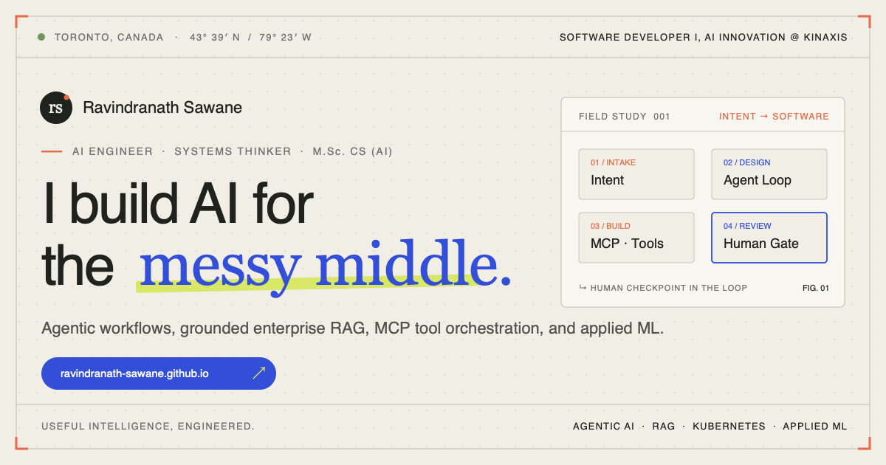

<p align="center">
  <a href="https://ravindranath-sawane.github.io/">
    
  </a>
</p>

# ravindranath-sawane.github.io

Editorial portfolio and interactive engineering field notes for **Ravindranath Sawane** — Software Developer I, AI Innovation at **Kinaxis** *(Toronto, Canada)*.

**Live Site:** **[https://ravindranath-sawane.github.io/](https://ravindranath-sawane.github.io/)**

---

## Architecture & Highlights

- **Zero-Build Static Performance** — Semantic HTML5, bespoke CSS architectural diagrams, and vanilla ES6+ JavaScript with progressive GSAP / ScrollTrigger choreography.
- **Editorial Dual-Theme System** — Seamless **Paper** (`#F1EEE6`) and **Night Study** (`#121512`) themes honoring `prefers-color-scheme` with persistent zero-FOUC theme switching.
- **Interactive Case Studies (`#work-devx`, `#work-kinara`, `#work-jiraxis`, `#work-research`)** — Keyboard-accessible WAI-ARIA tablist with deep-linkable URLs, one-click case link sharing, and CSS/SVG process illustrations rather than static stock screenshots.
- **Open-Source & Research Field Notes** — Direct index of open-source repositories ([`ChainSight-AI`](https://github.com/ravindranath-sawane/ChainSight-AI), [`CreditCairn`](https://github.com/ravindranath-sawane/CreditCairn), [`Zero-To-GenAI`](https://github.com/ravindranath-sawane/Zero-To-GenAI)), enterprise footprint ([`@rsawane-kxs`](https://github.com/rsawane-kxs)), and M.Sc. research publications ([Google Scholar](https://scholar.google.ca/citations?user=m-A0ZYgAAAAJ&hl=en)).
- **Accessibility & SEO** — Reduced-motion support (`prefers-reduced-motion`), keyboard focus rings, `JSON-LD` `Person` structured data, custom `rs↗` SVG favicon, and `1200×630` Open Graph social preview card.

## Local Preview

No build step or bundler required—serve the root directory with any static server:

```bash
python3 -m http.server 8080
```

Then visit `http://localhost:8080`.
